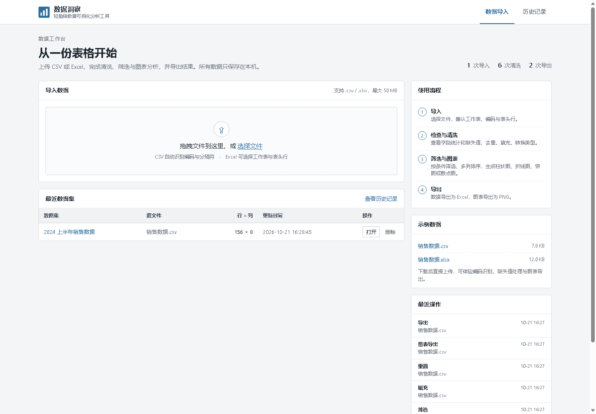
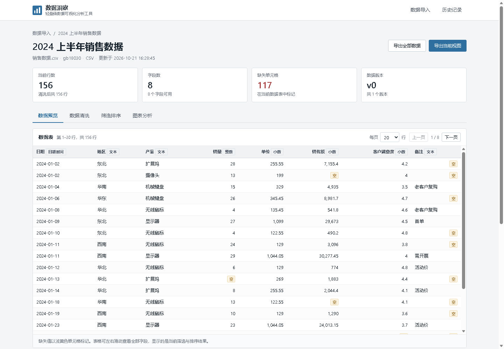
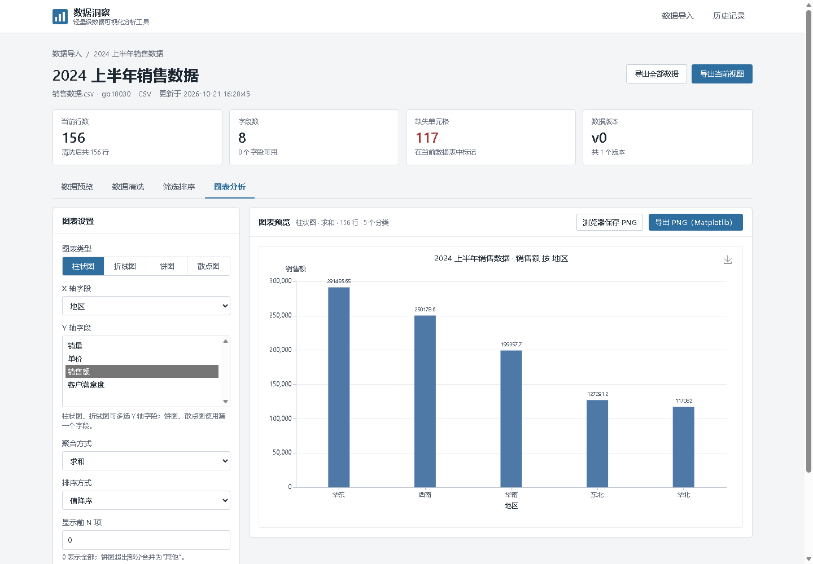
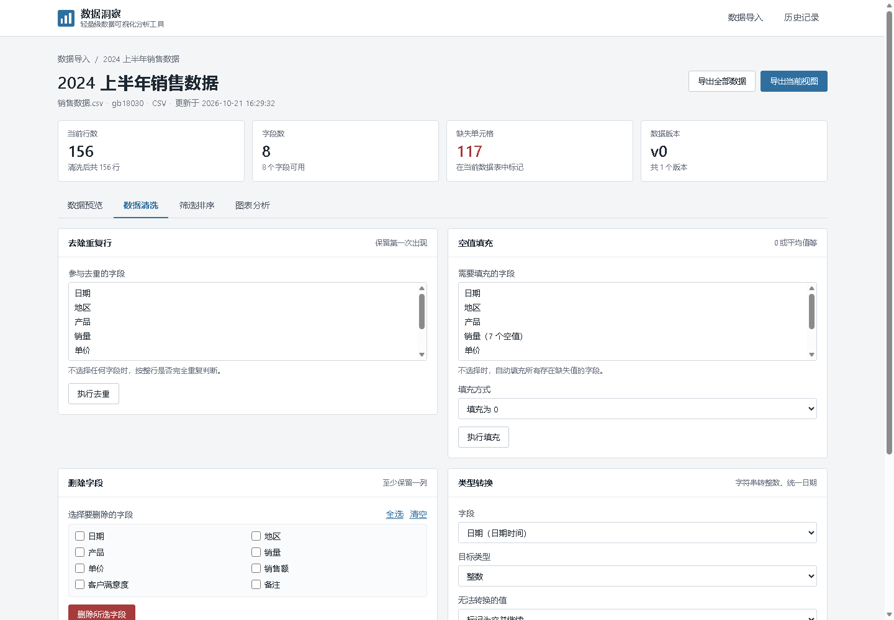
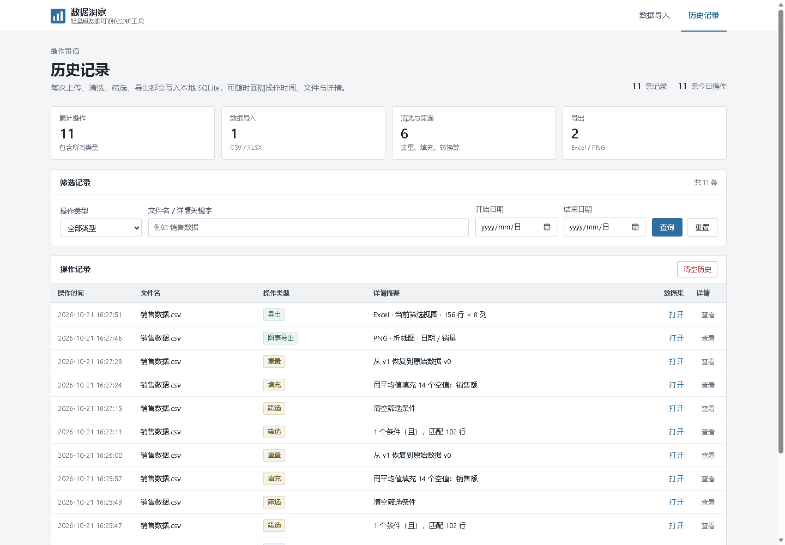

# 数据洞察 · 轻量级数据可视化分析工具

根据《开发文档》实现的本地数据分析应用：导入 CSV / Excel，完成字段检查、数据清洗、筛选排序、交互图表和结果导出，并把每一次关键操作写入 SQLite。

界面采用朴素、扁平的白底卡片风格：**无玻璃拟态、无模糊背景、无渐变、无阴影**，只用细边框和低饱和蓝色区分层级与操作。



## 功能一览

| 文档模块 | 实现内容 |
| --- | --- |
| 文件导入 | 上传 `.csv` / `.xlsx`；自动识别 UTF-8、GB18030/GBK、Big5 等编码；识别分隔符；选择 Excel 工作表；设置表头行；显示自动推断的字段类型 |
| 数据预览 | 分页表格；字段统计（非空、缺失、缺失率、均值、最小值、最大值、唯一值）；缺失单元格浅黄色标记 |
| 数据清洗 | 去重（可指定参与字段）；空值填充（0 / 平均值 / 中位数 / 众数 / 自定义值）；删除指定列；字符串转整数/小数、统一日期时间 |
| 筛选与排序 | 数值范围筛选、关键字包含/不包含、等于/不等于、为空/不为空；AND / OR 组合；最多 5 列多列排序 |
| 图表生成 | 柱状图、折线图、饼图、散点图；自选 X / Y 字段；求和/平均值/计数/最大/最小聚合；前 N 项；排序；ECharts 前端交互 |
| 导出 | 清洗后的数据导出为 Excel（当前筛选视图或全部数据，附导出说明页）；图表导出为 PNG（Matplotlib 静态图，另支持浏览器保存） |
| 历史记录 | 上传、清洗、筛选、排序、导出、撤销、重置、删除均写入 SQLite；按类型/文件名/日期筛选，查看操作时间、文件名、类型和 JSON 详情 |
| 数据库设计 | 严格一张表 `operation_log`：id、文件名、操作类型、操作时间、操作详情（JSON） |

## 界面截图

数据预览与字段统计：



图表分析（ECharts 交互图 + Matplotlib 导出）：



数据清洗与版本记录：



历史记录：



## 技术栈

- 后端：Python 3.10+、Flask 3.1
- 数据处理：Pandas 2.2、NumPy 1.26
- 数据库：SQLite（Python 内置 `sqlite3`）
- 前端：原生 HTML / CSS / JavaScript、ECharts 4.9（已本地内置，无需联网）
- 静态图：Matplotlib 3.9（Agg 后端）
- Excel：openpyxl
- 编码识别：charset-normalizer + 回退探测

## 快速开始

### 方式一：Windows 双击启动

双击项目根目录的 `run.bat`。脚本会自动寻找可用的 Python，启动服务并打开浏览器：

```text
http://127.0.0.1:5000
```

### 方式二：手动安装（推荐）

```bat
cd /d 项目目录
python -m venv .venv
.venv\Scripts\activate
pip install -r requirements.txt
python app.py --open
```

也可以指定端口：

```bat
python app.py --port 8080
```

> 依赖兼容说明：`deps.py` 会在启动时检测 Flask / Pandas / Matplotlib 等依赖；若当前解释器没有安装，会尝试在同版本的 Windows 用户级 `site-packages` 中查找。正常部署仍建议使用上面的虚拟环境安装方式。

## 使用流程

1. **导入**：拖入 CSV / XLSX。Excel 可选择工作表；CSV 可调整编码与分隔符；表头行可调整。
2. **预览**：查看分页数据、类型、缺失值分布和字段统计，确认导入是否符合预期。
3. **清洗**：按需去重、填充、删除字段或转换类型。每次实际修改都会生成一个版本，可撤销或恢复原始数据。
4. **筛选排序**：添加条件后应用，仅影响预览、图表和“当前视图”导出，不会破坏清洗后的完整数据。
5. **图表**：选择图表类型、X/Y 字段和聚合方式生成图表；可导出 Matplotlib PNG 或使用 ECharts 工具箱保存图片。
6. **导出**：页面右上角“导出当前视图 / 导出全部数据”生成 Excel。
7. **历史**：在“历史记录”中按类型、文件名和日期查询所有操作。

### 示例数据

`sample_data/` 已附带：

- `销售数据.csv`：GBK 编码、156 行，包含重复行、缺失值、混合日期格式，用于体验编码识别与清洗；
- `销售数据.xlsx`：包含“销售明细”和“区域汇总”两个工作表，用于体验 Sheet 选择。

首页的“示例数据”卡片可以直接下载。

## 目录结构

```text
.
├─ app.py                  Flask 路由、API 与启动入口
├─ config.py               路径、限制、配色与枚举配置
├─ database.py             SQLite 单表历史记录
├─ deps.py                 第三方依赖路径兼容层
├─ requirements.txt
├─ run.bat                 Windows 一键启动
├─ services/
│  ├─ importer.py          编码识别、CSV/Excel 读取、类型推断
│  ├─ storage.py           数据集与版本持久化
│  ├─ serialize.py         JSON 转换与字段统计
│  ├─ cleaner.py           去重、填充、删列、类型转换
│  ├─ filters.py           筛选与多列排序
│  ├─ charts.py            ECharts / Matplotlib 图表数据
│  ├─ exporter.py          Excel 导出与样式
│  └─ history.py           历史记录摘要
├─ templates/              Jinja 页面
├─ static/
│  ├─ css/app.css          朴素扁平样式
│  ├─ js/                  common / index / workspace / history
│  └─ vendor/echarts.min.js
├─ sample_data/            示例 CSV 与 XLSX
├─ tests/test_app.py       端到端测试
├─ docs/                   README 截图
└─ data/                   运行时生成（数据库、数据集版本）
```

## 数据与数据库

### 历史记录表（唯一一张表）

```sql
CREATE TABLE operation_log (
    id             INTEGER PRIMARY KEY AUTOINCREMENT,
    file_name      TEXT NOT NULL,
    operation_type TEXT NOT NULL,
    operation_time TEXT NOT NULL,
    detail         TEXT NOT NULL DEFAULT '{}'
);
```

`operation_type` 取值包括：上传、去重、填充、删除列、类型转换、筛选、排序、导出、图表导出、撤销、重置、删除数据集。`detail` 保存该次操作的字段、行数、条件、文件名等 JSON 信息。

### 数据集版本

- SQLite 只保存操作日志；数据本体保存在 `data/datasets/<id>/`：
  - `meta.json`：名称、源文件、Sheet、编码、字段信息、筛选/排序状态、图表配置；
  - `v0.pkl`：原始数据；`v1.pkl`、`v2.pkl`……：每次清洗后的版本。
- 撤销会把版本指针回退并删除后续版本；恢复原始数据会回到 `v0` 并清空筛选、排序、图表配置。
- 上传的临时文件在导入成功后会删除，超过 24 小时的残留临时文件会在启动时清理。

## 设计说明

- **无玻璃特效**：所有面板、按钮、输入框、弹层均为不透明纯色；未使用 `backdrop-filter`、`box-shadow`、`linear-gradient` 或半透明卡片。
- **配色**：背景 `#f4f5f6`，面板 `#ffffff`，边框 `#d9dee3`，主色 `#2f6f9f`；图表使用低饱和的 Tableau muted 色板。
- **布局**：顶部导航 + 单列工作区；统计卡片和表格均使用 1px 边框；窄屏下自动改为单列/双列。
- **字体**：优先 `Microsoft YaHei`，同时配置 Matplotlib 中文字体，避免图表中文方块。

## 测试

```bat
python -m unittest discover -s tests -v
```

测试覆盖：GBK 编码识别、CSV 导入、Excel 多 Sheet 选择、类型推断、分页、去重、平均值填充、删列、类型转换、撤销/重置、筛选排序、四种图表、Excel 导出、Matplotlib PNG、历史记录、删除数据集与 404 处理。

当前测试结果：**7 项通过**。

## 常见问题

**端口被占用**

```bat
python app.py --port 8080
```

**CSV 打开后中文乱码**

在导入面板中手动切换“文件编码”（GB18030/GBK、UTF-8、Big5 等），预览会立即刷新。

**Excel 日期显示为数字或文本**

在“数据清洗 → 类型转换”中选择目标类型“日期时间”；如果原格式特殊，可填写格式（如 `%Y/%m/%d`），无法转换的值可选择置空或中止。

**Matplotlib 导出的中文变成方块**

程序会自动选择 `Microsoft YaHei` / `SimHei` 等系统字体。若系统没有中文字体，请安装其中任意一种后重启。

**导出的 Excel 很大或较慢**

默认上限为 50 MB 上传、20 万行导入。大数据量导出需要几十秒，属于正常现象。

**数据保存在哪里，是否会上传网络**

全部保存在本机 `data/` 目录和 SQLite 中；ECharts 为本地文件，运行不依赖外网。

## 限制

- 仅支持 `.csv` 与 `.xlsx`，不支持旧版 `.xls`。
- 导入上限 50 MB、20 万行；超出部分会截断并提示。
- 本地单用户工具，未实现登录与权限体系，请勿直接暴露到公网。
- 饼图/散点图只使用第一个 Y 字段；柱状图/折线图最多 8 个 Y 字段。
